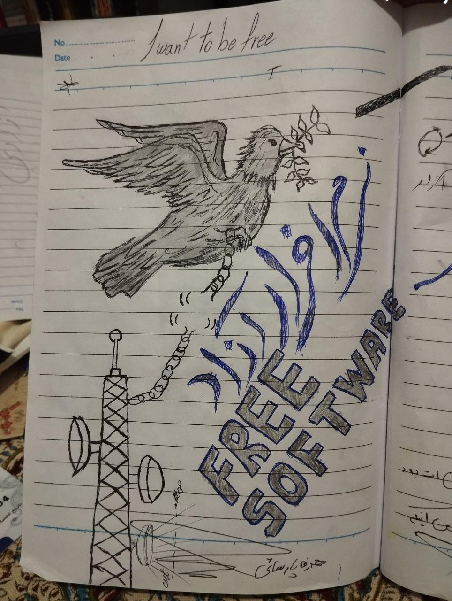
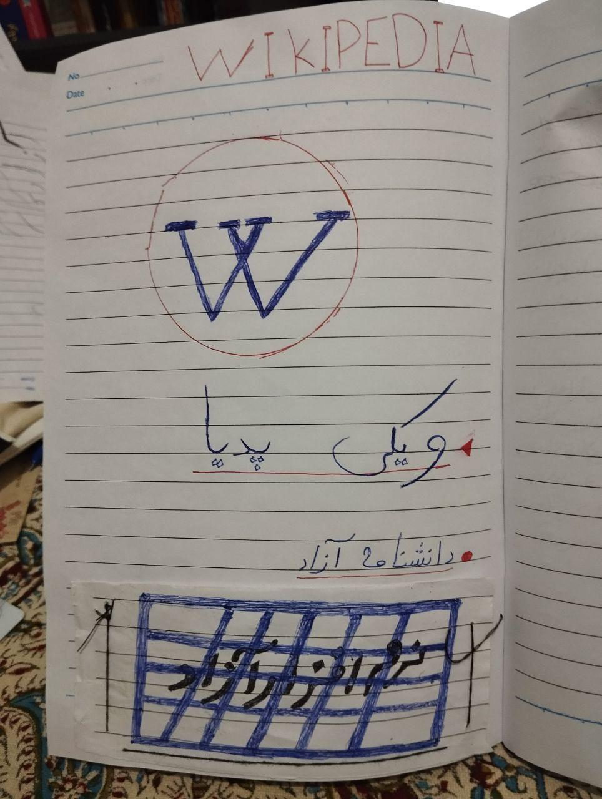
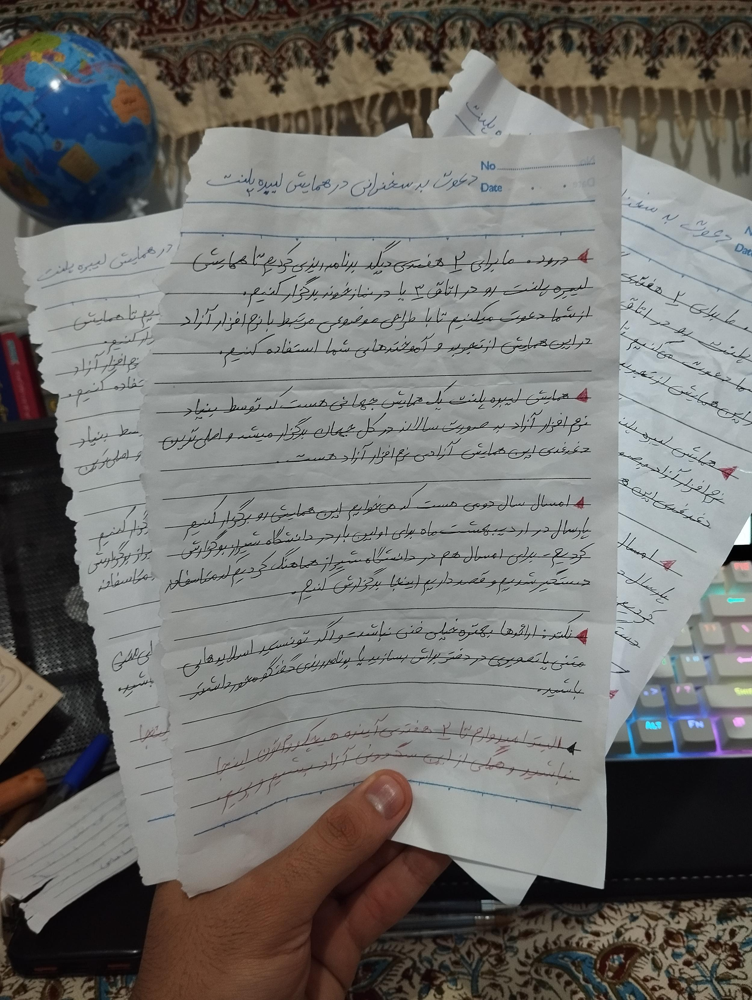
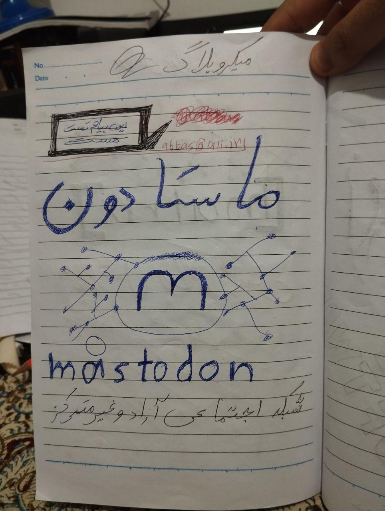
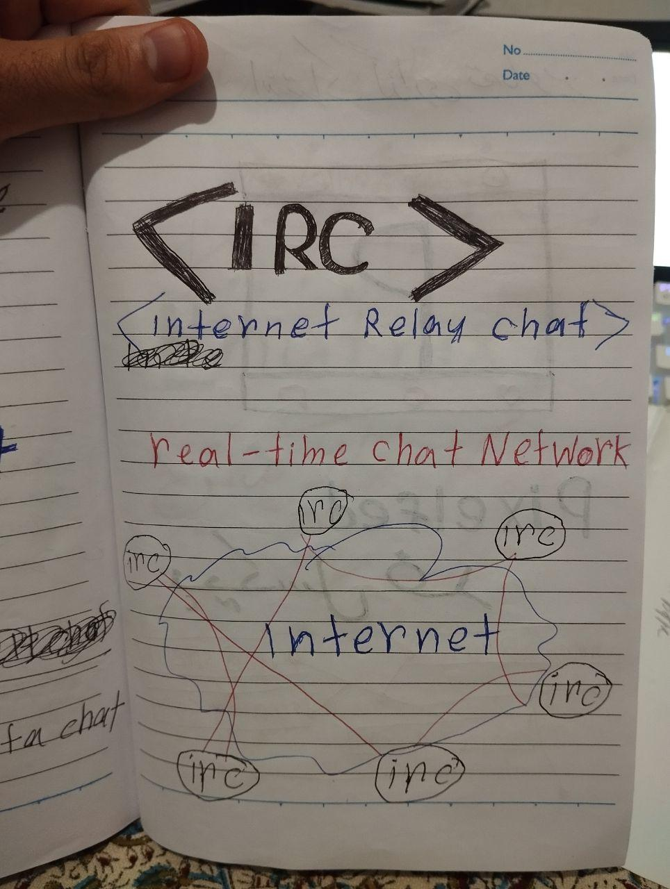
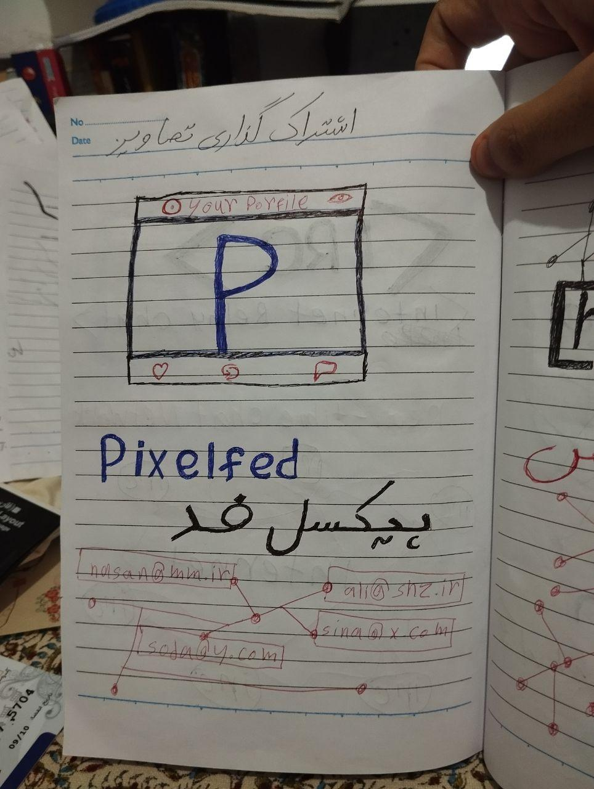
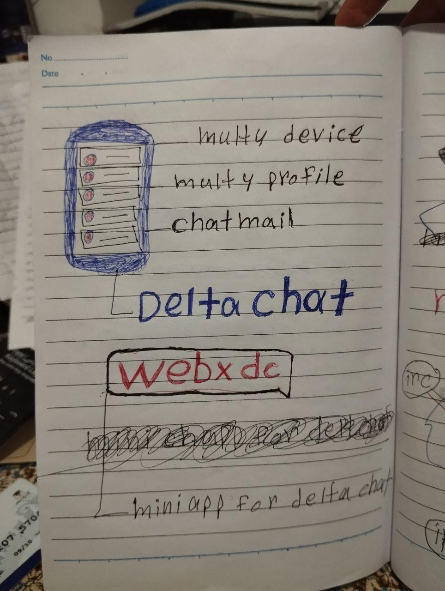
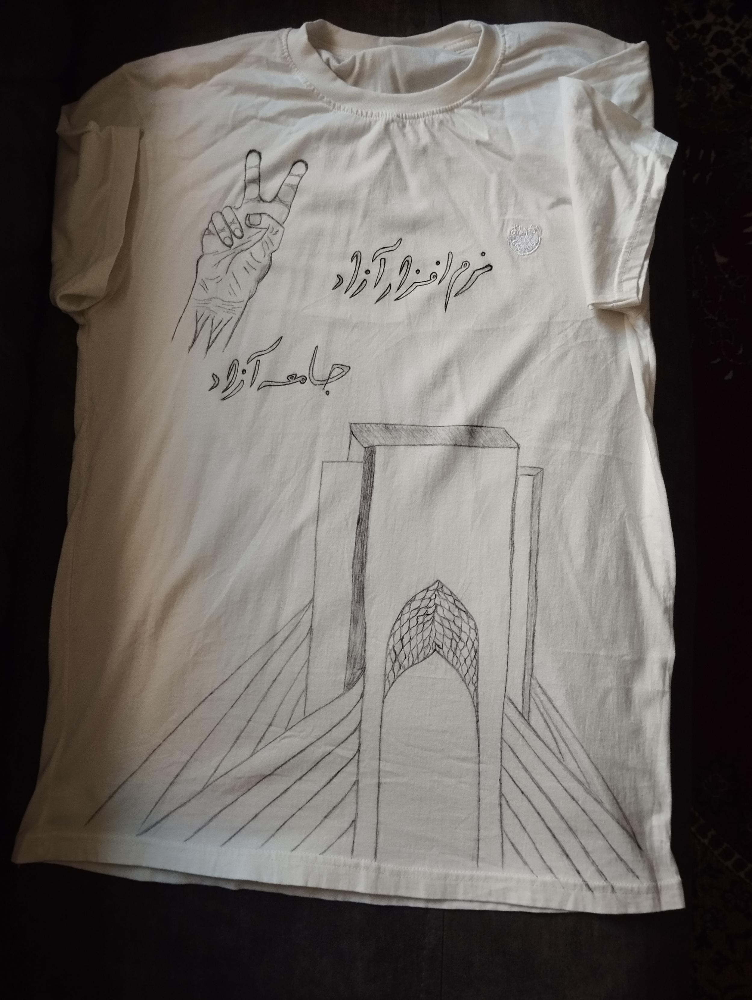

نرم‌افزار آزاد، جامعه آزاد

این شعار همیشه جمله آخر ارائه‌های من برای معرفی نرم‌افزار آزاد بود.

ارائه‌هایی که موضوعشان هماهنگ شده بود تا در کنفرانس جهانی [#لیبرپلنت](<https://techhub.social/tags/LibrePlanet>) (https://libreplanet.com/) در دانشگاه شیراز (https://shirazu.ir/) برگزار شود.

ولی تقدیر طور دیگری شد و این کنفرانس به‌جای دانشگاه شیراز، در زندان شیراز برنامه‌ریزی و اجرا شد.

البته آن موقع زندان شیراز برای ما حکم دانشگاه را داشت. فضایی پر از هنرمند، مهندس، پزشک و آدم تحصیل‌کرده که هر کدام به اتهام اقدام علیه امنیت ملی یا فعالیت سیاسی زندانی بودند.

این شوخی همیشگی ما بود. می‌گفتیم با این حجم محدودیت و هشدار نهادهای نظارتی و دولتی، آخرش مجبور می‌شویم کنفرانس‌ها را در زندان برگزار کنیم.

بارها برای حاشیه‌های رویدادها تعهد داده بودم و چند بار هم با دستور قضایی از رفتن به مراکز مربوط منع شده بودیم.

جمع شدن همین اتفاق‌ها بود که محل برگزاری را از دانشگاه و مرکز نوآوری برد به کافه و پارک.

ولی در نهایت همان شوخی تلخ ما واقعی شد و این بار نوبت زندان بود که میزبان رویداد و کنفرانس نرم‌افزار آزاد شود.

بعد از قطعی سراسری اینترنت در دسامبر ۲۰۲۵، توانستیم از مرز ۵۰۰ هزار کاربر روی سرورهای نامتمرکز رد شویم و موج بعدی ترویج دلتاچت با قطعی سراسری اینترنت در فوریه ۲۰۲۶ شروع شد.

در این موج جدید، گسترش دلتاچت آن‌قدر وسیع شده بود که دیگر لازم نبود آن را به توسعه‌دهنده یا کاربر معرفی کنیم. کافی بود پیشنهاد کنیم سرور خودشان را راه بیندازند.

برای زیرساخت بیشتر به حمایت مالی نیاز داشتیم. بنیادهای مختلف از دانشگاه‌های خارج از ایران و تعدادی داوطلب حدود ۴۵۰۰ دلار کمک هزینه جمع کردند.

قرار بود این مبلغ از راه یک صرافی به حساب ایرانی منتقل شود و چون در شرح تراکنش «حمایت مالی» آمده بود، به خاطر تحریم، حساب مبدأ مسدود شد و پول به ما نرسید.

خوشبختانه بعداً حدود ۲۴۰۰ تتر (USDT) از همان اعضا به دستمان رسید.

با این پول سرورهای تازه خریدیم و به گرداننده‌ها هم حمایت مالی دادیم. چند بار شرکت‌های میزبانی سرورهای مختلفی در اختیارمان گذاشتند که آن‌ها را به گرداننده‌ها دادیم تا رله بیشتری برای بقیه فراهم کنند.

اواسط فوریه ۲۰۲۶ مجموع کاربران همه سرورها به حدود ۶ میلیون رسید و با ادامه قطعی اینترنت این عدد همچنان بالا می‌رفت.

ولی دقیقاً همان موقع حدود ۵۰ درصد سرورها یکی‌یکی فیلتر و مسدود می‌شدند. روشن شده بود که سانسورکننده، به هر دلیلی، تصمیم گرفته علیه سرورهای نامتمرکز دلتاچت کمپین راه بیندازد و همه را فیلتر کند.

اول حدس زدیم به‌خاطر شباهت شدوساکس روی دلتاچت، سرورها با سرور VPN اشتباه گرفته و فیلتر می‌شوند. ولی حتی بعد از درست کردن این مورد، روند فیلتر شدن تغییری نکرد.

در آن دوره دست‌کم ۶۵۰ سرور از سمت گرداننده‌ها «مسدود» گزارش شد.

آن زمان حدود ۵۰۰ میلیون تومان خسارت مالی از فیلتر شدن سرورها به گرداننده‌ها وارد شده بود و نمی‌توانستیم برای جبران خسارت کمک مالی جمع کنیم، چون خودمان دیگر به اینترنت آزاد دسترسی نداشتیم که این را گزارش کنیم.

فقط در ایران حدود ۳۰ درصد این مبلغ را کاربران برای گرداننده‌ها جبران کردند، ولی در مجموع آسیب مالی گسترده بود و همراه آن، با خاموش شدن بیشتر سرورها، تعداد کاربران به زیر ۲ میلیون می‌افتاد و هر روز کمتر می‌شد. دلیلش را در ادامه می‌گویم.

نکته این بود که هیچ مبنای قانونی یا حتی هشداری برای کسی وجود نداشت. ولی ترس بین گرداننده‌ها پخش شده بود. خیلی‌ها به‌خاطر حجم بالای ترافیک یا تعداد کاربر، از ترس گرفتار شدن در دردسر پیش‌بینی‌نشده، داوطلبانه سرویسشان را خاموش کردند. اینجا هم پخش شدن ترس بین گرداننده‌ها اثر منفی خودش را گذاشت، هرچند احتیاط عاقلانه‌تر است.

۲۹ مارس ۲۰۲۶ بود. نشسته بودم و چند قابلیت نسخه جدید دلتاچت را چک می‌کردم که یک‌باره در زدند. در را که باز کردم چند نفر ریختند داخل خانه، دستبند زدند و بعد همه دستگاه‌های الکترونیکی را ضبط کردند. خلاصه هم من را بردند هم تجهیزات را.

بعد از ۱۸ روز بازجویی در بازداشتگاه پلاک ۱۰۰، به بند قرنطینه زندان عادل‌آباد منتقل شدم و بعد از حدود ۳ ماه با قرار وثیقه موقتاً آزاد شدم.

اتهام‌های مختلفی علیه من بود. اصلی‌ها تبلیغ، ترویج و فراهم کردن زیرساخت برای پیام‌رسان‌های آزاد و نامتمرکز، از جمله دلتاچت، جمی و ماتریکس و مانند این‌ها بود. کنارشان تبلیغ علیه نظام، اقدام علیه امنیت ملی و ۳ اتهام دیگر که نمی‌خواهم اینجا بیاورم، بخشی از لیست اتهام‌های من است.

در تمام این بازجویی‌ها و بررسی‌ها، مستقیم و قاطع از نرم‌افزار آزاد دفاع کردم (البته نرم‌افزار آزاد به دفاع نیاز ندارد؛ من از فعالیت خودم در این جنبش دفاع کردم) و سعی کردم نرم‌افزار آزاد را طوری توضیح بدهم که فهمیده شود این یک انتخاب برای کنترل حریم خصوصی خود آدم است، و اسمش ترویج یک شبکه تروریستی نیست، یا کسی که به‌جای ایتا و سروش از دلتاچت استفاده می‌کند این کار را نمی‌کند چون می‌خواهد علیه امنیت ملی فعالیت کند. گاهی خود حریم خصوصی و آزادی موضوع اصلی است، و حالا کنترل فضای اینترنت با فیلتر کردن سرورهایی که برای جمع کردن اعضای یک خانواده راه افتاده‌اند را نمی‌شود اقدام امنیتی نامید. یک جا در ویدیوکنفرانس با بازپرس دیدم برای برگزاری جلسه آنلاین دادگاه از یک ابزار ویدیویی آزاد استفاده می‌کنند. همان‌جا مستقیم گفتم: «نمی‌شود مصرف‌کننده نرم‌افزار آزاد بود و ترویجش را جرم دانست.»

در همه دفاع‌های آخرم، دقیقاً همان‌جایی که قرار بود پشیمانی نشان بدهم، روشن گفتم قطعی اینترنت راه‌حل ضد مردم است. تلاش و ارتباطم با گروه اینترنت آزاد را اصلاً اشتباه نمی‌دانستم و درباره این اتهام‌ها پشیمانی حس نمی‌کردم.

تحت هیچ شرایطی فعالیت تبلیغی‌ام برای نرم‌افزار آزاد را اقدام علیه امنیت ملی، یا هر اسمی که رویش می‌گذارند، نمی‌دانم.

خیلی از دوستان و همکاران از دستگیری‌ام باخبر بودند و به درخواست خودم آن را عمومی نکردند.

تصمیم به عمومی نکردن و بستن کل گروه شیرازلینوکس ([گفتگوی شیرازلینوکس](<https://matrix.to/#/%23shirazlinuxchat:matrix.org>)) به این دلیل بود که دستگیری‌ام مشخصاً سر دلتاچت بود. در همین دوره تعداد زیادی سرور فیلتر شده بود و گروه ارتباطی ما دست‌کم ۲۰۰ تا ۳۰۰ توسعه‌دهنده را پوشش می‌داد. پخش خبر دستگیری من به‌خاطر دلتاچت، آن هم وقتی دلتاچت بین مردم گسترده استفاده می‌شد، می‌توانست ترس بیشتری برای گرداننده‌ها بسازد و خاموشی سرور بیشتری ببینیم، که اصلاً به نفع جامعه ما نبود.

در حالی که این موضوع فقط به من مربوط بود و مسئله نیت ترویج بود. وگرنه با گرداننده‌ها مسئله‌ای نداشتند، جز فیلتر کردن سرورها که ظاهراً مدتی است آن را هم متوقف کرده‌اند.

## شرح برگزاری رویداد و کنفرانس نرم‌افزار آزاد در زندان و بازداشتگاه

همراه آدم‌های مختلف، هم در بازداشت و هم در زندان، رویداد و کنفرانس‌های مختلفی برگزار کردیم و سعی کردیم فعالیت را داخل همین فضاها ادامه دهیم.

تا وقتی در بازداشتگاه بودیم بیشتر ارائه گفتگومحور داشتیم، چون آنجا تجهیزات ارائه اسلاید نداشتیم.

ولی در زندان اسلاید ارائه را با خودکار توی دفتر طراحی می‌کردیم. بعضی دوستان یک کلاس آموزشی کامل را روی کاغذ توضیح می‌دادند و ارائه می‌کردند و موضوع‌های فنی را نظری پوشش می‌دادند.

چند بار به رئیس زندان نامه نوشتیم و اجازه خواستیم خانواده‌ها چند کتاب آموزشی برایمان بیاورند تا این کار را بهتر ادامه دهیم. ولی به دلیلی که معلوم نشد، ورود هر کتاب آموزشی مرتبط با کامپیوتر، کتاب زبان انگلیسی و چیزهای مشابه کاملاً ممنوع بود.

## روش اعلام رویداد و کنفرانس

هماهنگ کردن رویدادها کار پیچیده‌ای نمی‌خواست. در بازداشتگاه پلاک ۱۰۰ معمولاً موضوع حوالی ظهر یا عصر همان روز انتخاب می‌شد، همه برای شرکت موافق می‌شدند و رویداد همین‌طور برگزار می‌شد.

در زندان هم زمان و اتاق را هماهنگ می‌کردیم و برنامه را اجرا می‌کردیم.

ولی برای کنفرانس لیبرپلنت هماهنگی باید زودتر انجام می‌شد، هم برای جلسه‌های اردیبهشت و هم خرداد. متن اعلام را روی تکه‌های مختلف کاغذ می‌نوشتیم و بین آدم‌های فنی بند قرنطینه پخش می‌کردیم.

البته اعلامیه‌ها را باید خیلی بااحتیاط پخش می‌کردیم، چون نباید حول این فعالیت‌ها سر و صدا می‌شد. زندان قاعده خودش را داشت و این رویدادها و کنفرانس‌ها ممکن بود سوءتفاهم بسازد که کار خلافی می‌کنیم. برای همین در انتخاب ارائه‌دهنده و شکل اجرای کنفرانس خیلی حساس بودیم و اصلاً بابت آن هیاهو نکردیم.

## فهرست رویدادها و کنفرانس‌ها

گفتگوی آزاد: اینترنت آزاد
تاریخ: ۱ آوریل ۲۰۲۶ | مدت: حدود ۲ ساعت
محل: بازداشتگاه پلاک ۱۰۰

حریم خصوصی در دنیای دیجیتال و معرفی و اهمیت نرم‌افزار آزاد
تاریخ: ۳ آوریل ۲۰۲۶ | مدت: حدود ۱٫۵ ساعت
محل: بازداشتگاه پلاک ۱۰۰

گفتگوی آزاد: اینترنت آزاد
تاریخ: ۴ آوریل ۲۰۲۶ | مدت: حدود ۲ ساعت
محل: بازداشتگاه پلاک ۱۰۰

گفتگوی آزاد: امنیت دیجیتال
تاریخ: ۱۳ آوریل ۲۰۲۶ | مدت: حدود ۱ ساعت
محل: بازداشتگاه پلاک ۱۰۰

گفتگوی آزاد: سیستم‌عامل‌های گنو/لینوکس
تاریخ: ۲۳ آوریل ۲۰۲۶ | مدت: ۲ ساعت
محل: زندان مرکزی شیراز

کارگاه نتورک‌پلاس
تاریخ: ۵ تا ۲۰ مه ۲۰۲۶ | مدت: بین ۲ تا ۴ ساعت
محل: زندان مرکزی شیراز

کنفرانس لیبرپلنت
تاریخ: ۱۴ و ۱۵ مه، و ۲۸ و ۲۹ مه ۲۰۲۶
موضوع‌ها: معرفی کنفرانس لیبرپلنت، نرم‌افزار آزاد چیست؟ انقلاب گنو/لینوکس، مفهوم نامتمرکز بودن؛ معرفی شبکه‌های اجتماعی نامتمرکز؛ معرفی ویکی‌پدیا، انواع پروانه نرم‌افزار آزاد، وردپرس فارسی، بلاک‌چین
زمان معرفی کنفرانس: ۱۵ دقیقه | هر ارائه: حدود ۳۰ دقیقه
محل: زندان مرکزی شیراز

آشنایی با ویکی‌پدیای فارسی
تاریخ: ۴ ژوئن ۲۰۲۶ | مدت: ۲ ساعت
محل: زندان مرکزی شیراز

چطور ویکی‌پدین‌نویس شویم؟
تاریخ: ۵ ژوئن ۲۰۲۶ | مدت: ۴ ساعت
محل: زندان مرکزی شیراز

توضیح انیمیشن «قهرمانان سفیدپوش» در دنیای واقعی پزشکی
تاریخ: تاریخ دقیق ندارد | مدت: ۲ ساعت
محل: زندان مرکزی شیراز

## شرایط زندان و محیط

این بخش را بیشتر می‌نویسم تا بدانید رویداد و کنفرانس را در چه شرایطی برگزار کردیم.

خیلی وقت‌ها بیمار بودیم. در یکی از رویدادها خودم آن‌قدر مریض بودم که ۴ بار جلسه را ترک کردم و برگشتم.

در بند قرنطینه بودیم. فضایی کاملاً نامناسب، پر از آلودگی و بیماری.

خودم ۳۰ روز اول مدام بیمار بودم. در واقع بیشتر آدم‌ها آنجا به این ویروس ناشناس مبتلا می‌شدند.

با همه این‌ها، امید تنها چیزی بود که بین ما جریان داشت و حتی در این وضع بیشتر آدم‌ها دنبال کار مفید بودند و سعی کردیم حتی در زندان صدای نرم‌افزار آزاد باشیم.

## توضیح درباره طرح تی‌شرت

همان‌طور که قبلاً گفتم، زندان پر از آدم تحصیل‌کرده بود. بینشان هنرمندهای مختلفی بودند که بعد از ارائه‌های من درباره نرم‌افزار آزاد، گروهی از این هنرمندها طرحی برایم پیدا کردند.

این طرح بر اساس مفهوم‌هایی بود که درباره چیستی نرم‌افزار آزاد برایشان گفته بودم، همراه همان شعار همیشگی پایان ارائه‌هایم.

این کار گروهی هنرمندهای بند بود و همه طرح‌ها با خودکار و مداد داخل خود زندان ساخته شد.

کسانی که در طرح تی‌شرت نقش داشتند:

Babal Shour Rahmati

Ali Zeynali

Sajjad Shafiei

Kia Mousavi

Soroush Zafar Abadi

Mohammad Reza Parsaei

Ghasem Rezaei

Siavash Zare

## حرف آخر

اول از همه از همه عزیزانی که صفحه حمایتشان را روی درگاه شیرازلینوکس ساخته بودند صمیمانه عذر می‌خواهم. به‌خاطر نبودن من و دسترسی محدود اعضای تیم، تسویه‌ها دیر شد. این تأخیر به‌خاطر شرایطی بود که برای من پیش آمد.

نمی‌دانم آینده چه می‌شود، ولی تلاش می‌کنیم مجبور نشوم به زندان برگردم و وکیلی هم برایم تعیین شده که این اتهام‌ها را پیگیری می‌کند.

در مجموع چیزی بود که پیش‌بینی می‌کردیم یک روز اتفاق بیفتد.

تنها آرزویم برای نسل‌های بعدی این سرزمین این است که برگزارکنندگان رویداد نرم‌افزار آزاد فقط یک دغدغه داشته باشند: تعیین تاریخ رویداد. نه ترس از تهدید، نه فیلتر، نه پیگرد.

به امید آینده‌ای زیبا برای ایران عزیز

اول بار در ماستودون: [techhub.social/@abbas_dp/116850818231544177](<https://techhub.social/@abbas_dp/116850818231544177>)
