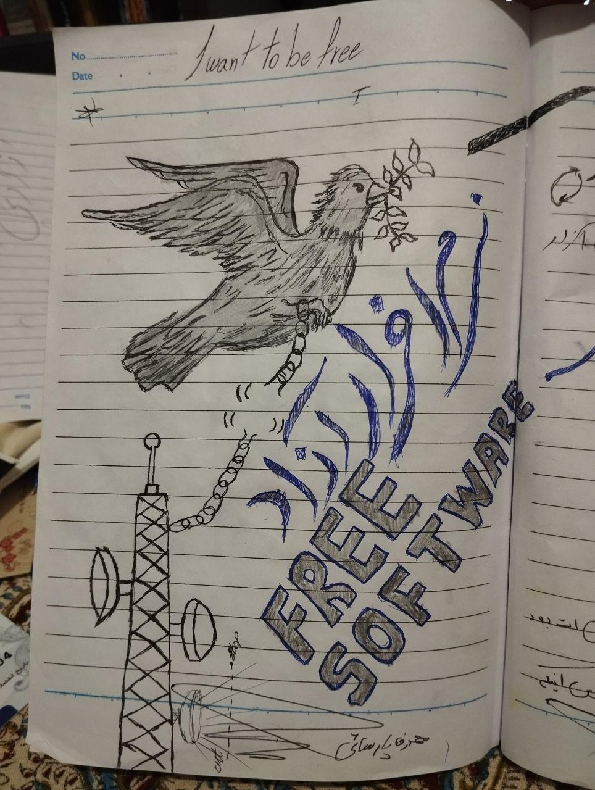
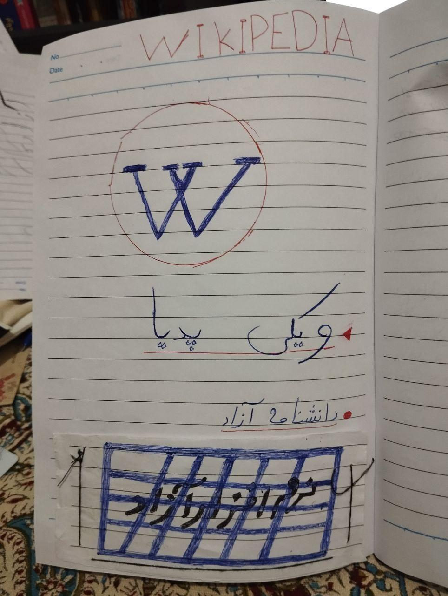
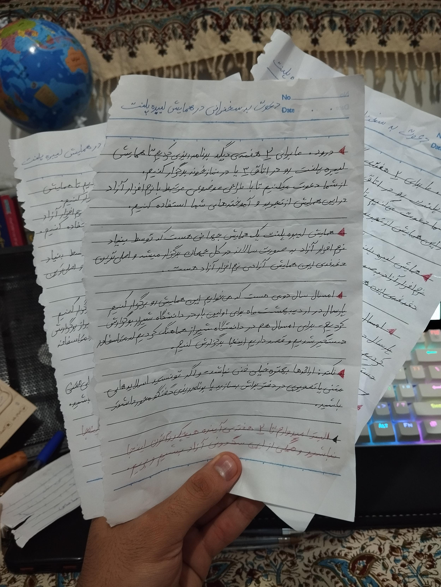
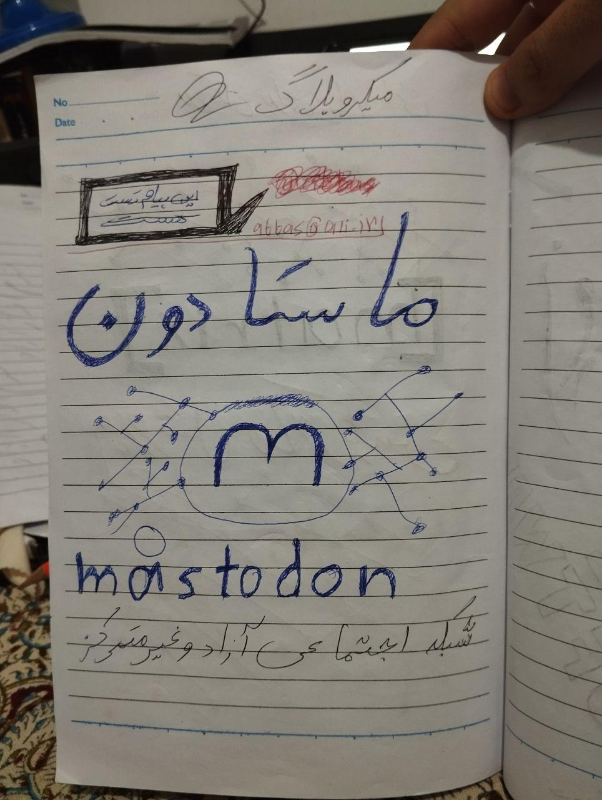
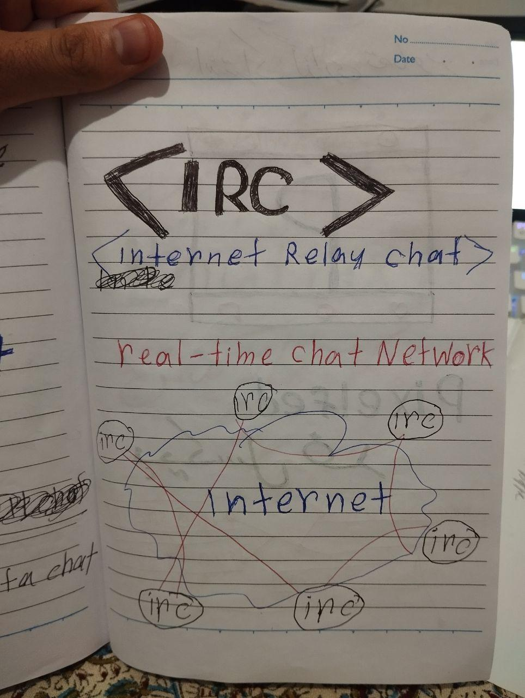
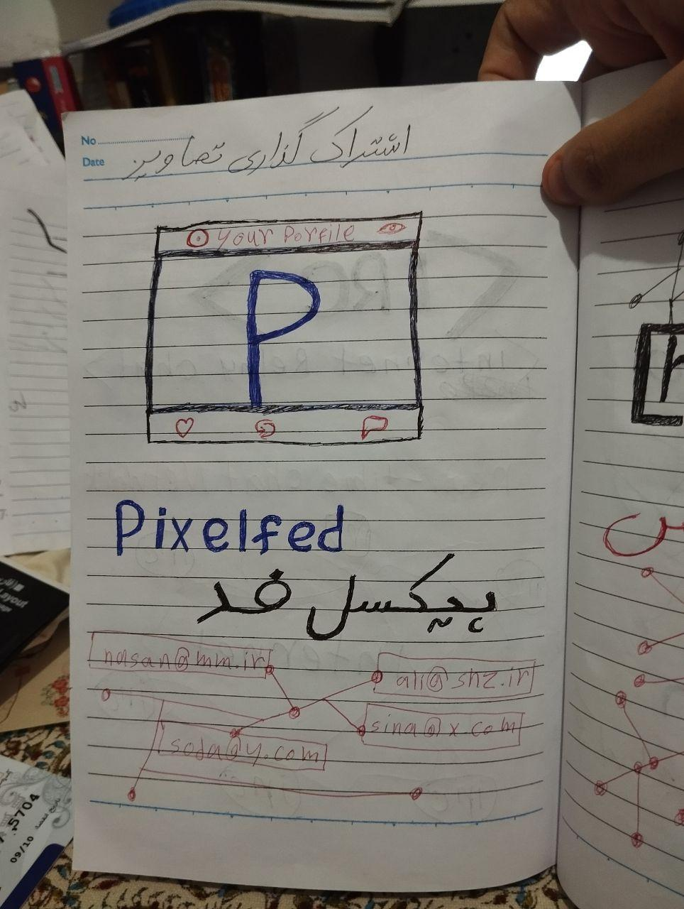
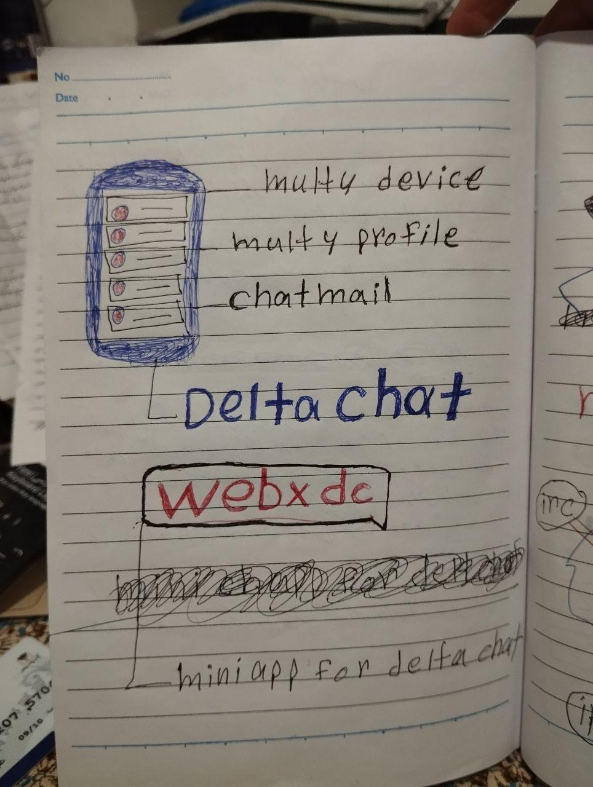
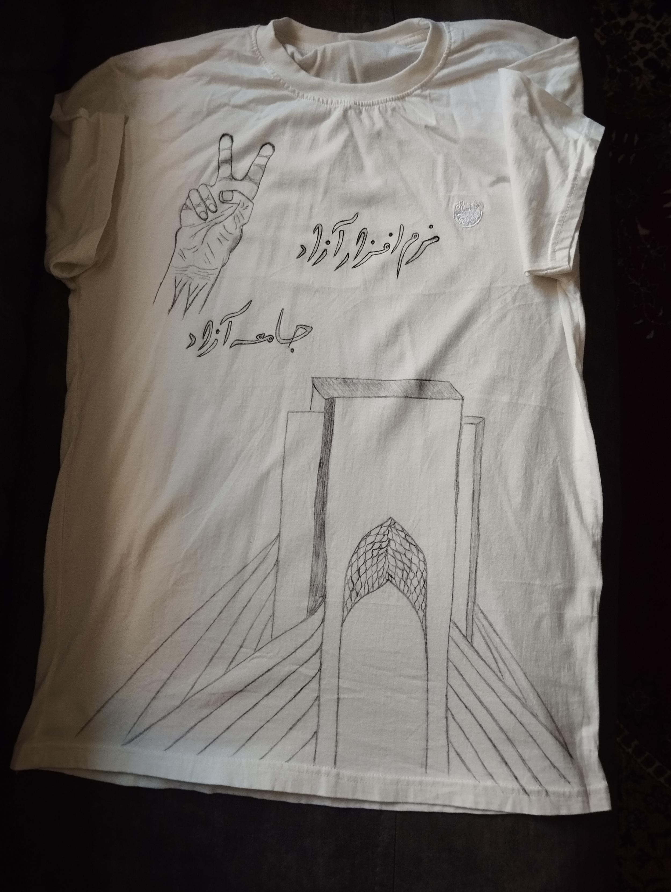

Free Software, Free Society

This slogan was always the last sentence of my presentations introducing free software.

Presentations whose topics were coordinated to be held at the global [#LibrePlanet](<https://techhub.social/tags/LibrePlanet>) conference (https://libreplanet.com/) at Shiraz University (https://shirazu.ir/).

But destiny turned out this way, and this conference was planned and executed in Shiraz Prison instead of Shiraz University.

Of course, at that time, Shiraz Prison served as a university for us; a space full of artists, engineers, doctors, and educated people, each of whom was imprisoned on charges of acting against national security or political activity.

It was a joke we always made. We used to say that with this many restrictions and warnings from regulatory and governmental bodies, we would eventually be forced to hold the conferences in prison.

I have signed undertakings regarding the margins of events many times, and on several occasions we were prohibited from attending relevant centers by judicial orders.

It was the accumulation of these very incidents that moved our venue from universities and innovation centers to coffee shops and parks.

But in the end, that same bitter joke of ours became reality, and this time it was prison's turn to host free software events and conferences.

After the nationwide internet shutdown in December 2025, we managed to pass the 500,000 user mark on decentralized servers, and the next wave of DeltaChat promotion began with the nationwide internet shutdown in February 2026.

In this new wave, the spread of DeltaChat had become so widespread that there was no longer any need to introduce it to developers or users. It was enough to suggest that developers or users set up their own servers.

To provide more infrastructure, we needed financial support. Various foundations from universities outside Iran and a number of volunteers raised about $4,500 in grants.

But this amount was to be transferred through an exchange to an Iranian account, and because "financial support" was mentioned in the transaction description, due to sanctions, the source account was blocked and the money did not reach us.

Fortunately, later we received about 2,400 Tether (USDT) from the same members.

We used these funds to purchase new servers and also provided financial support to the operators. On several occasions, multiple hosting companies provided us with various servers, which we donated to the operators so they could provide more relays for others.

In mid-February 2026, the total user count across all servers reached about 6 million, and as the internet shutdown continued, this number kept growing.

But exactly at that time, about 50% of the servers were being filtered and blocked one by one. It was now clear that the censor had decided to start a campaign against DeltaChat's decentralized servers, for whatever reason, and filter all of them.

At first we guessed that due to the similarity of ShadowSocks on DeltaChat, the servers were being mistaken for VPN servers and filtered. But even after fixing this, there was no change in the filtering trend.

During that period, at least 650 servers from the operators' side were reported as "blocked".

At that time, about 500 million Tomans in financial losses had been incurred by the operators due to the filtering of servers, and we could not collect financial aid to compensate for the losses because we ourselves no longer had access to the open internet to report this.

Only in Iran, about 30% of these amounts were compensated by the users for the operators, but overall the financial damage was extensive, and along with that, the user count was dropping below 2 million due to the shutdown of most servers and was decreasing every day; which I will explain why in the following.

The point here was that there was no legal basis or even any warning for anyone. But a fear had spread among the operators. Many, due to the high volume of traffic or the number of users, voluntarily shut down their services for fear of getting caught up in unforeseen troubles. And here too, the spread of fear among the operators had its negative effect, though caution is the better part of valor.

It was March 29, 2026. I was sitting and checking a few features of the new DeltaChat update when suddenly there was a knock at the door. When I opened the door, several people rushed into the house, handcuffed me, and then seized all the electronic devices. In short, they took both me and the equipment.

After an 18-day interrogation process at Detention Center Plak 100, I was transferred to the quarantine ward of Adelabad Prison, and after about 3 months, I was temporarily released on bail.

There were various charges against me. The main ones were advertising, promoting, and providing infrastructure for free and decentralized messengers, including DeltaChat, Jami, and Matrix, etc. Alongside them, propaganda against the regime, acting against national security, and 3 other charges which I do not want to mention here are part of my list of charges.

Throughout all these interrogations and investigations, I directly and decisively defended free software (of course, free software does not need defending; rather, I defended my own activities in this movement) and I tried to present free software in a way that is understandable, that this is a choice to control your own privacy, and its name is not promoting a terrorist network, or that someone who uses DeltaChat instead of Eita and Soroush does not do so because they want to engage in activity against national security; sometimes privacy and freedom themselves are the main issue, and now controlling the internet space by filtering servers that are set up to gather members of a family cannot be called a security measure. At one point during a video conference with the investigator, I noticed they were using a free video tool to host the online court session. Right there I directly said: "You cannot be a consumer of free software and criminalize its promotion."

In all my final defenses, exactly where I was supposed to express remorse, I clearly stated that the internet shutdown is an anti-people solution. I did not consider my efforts and connection with the free internet group a mistake at all, and I felt no remorse regarding these charges.

Under no circumstances do I consider my promotional activities for free software to be an act against national security or whatever they call it.

Many friends and colleagues were aware of my arrest, and at my own request, they did not publicize it.

The decision not to publicize and to close the entire ShirazLinux group ([ShirazLinux chat](<https://matrix.to/#/%23shirazlinuxchat:matrix.org>)) was because my arrest was specifically over DeltaChat. A large number of servers had been filtered during this same period, and our communication group covered at least 200 to 300 developers. The spread of news about my arrest over DeltaChat, especially at a time when DeltaChat was widely used among the public, could have created more fear for its operators, and we would have seen even more server shutdowns, which was not in the interest of our community at all.

While this matter only involved me, and the issue was about the intent to promote; otherwise, they had no issue with the operators, except for filtering servers, which apparently they have stopped doing for a while now.

## A description of holding free software events and conferences in prison and detention center

Along with many different people, both during detention and in prison, we held various events and conferences and tried to continue our activities within these spaces.

As long as we were in the detention center, we mostly had dialogue-based presentations, because we did not have the equipment for slide presentations there.

But in prison, we designed presentation slides with pens in notebooks. Some friends would fully explain and present entire training classes on paper and would cover technical topics theoretically.

We wrote to the prison warden several times requesting permission for our families to bring us some educational books so we could better continue this work. But for some unknown reason, the entry of any computer-related educational books, English language books, and similar items was absolutely forbidden.

## The method of announcing events and conferences

Coordinating the events did not require much complex work. In Detention Center Plak 100, the topic would generally be chosen around noon or evening of the same day, and everyone would agree to participate, and that's how we held the event.

In prison as well, we would coordinate the time and room and run the program.

But for the LibrePlanet conference, coordination needed to happen earlier - both for the Ordibehesht and Khordad sessions. We would write the announcement text on different pieces of paper and share it among the technical people in the quarantine ward.

Of course, we had to distribute the announcements very carefully, because we shouldn't make any noise about these activities, as the prison had its own rules, and these events and conferences could potentially cause misunderstandings that we were doing something wrong. So we had to be very sensitive in choosing the presenters and the execution format of the conference, and we didn't make any fuss about it at all.

## List of events and conferences

Open discussion: Free Internet
Date: April 1, 2026 | Duration: about 2 hours
Location: Detention Center Plak 100

Privacy in the digital world and introduction and importance of free software
Date: April 3, 2026 | Duration: about 1.5 hours
Location: Detention Center Plak 100

Open discussion: Free Internet
Date: April 4, 2026 | Duration: about 2 hours
Location: Detention Center Plak 100

Open discussion: Digital Security
Date: April 13, 2026 | Duration: about 1 hour
Location: Detention Center Plak 100

Open discussion: GNU/Linux operating systems
Date: April 23, 2026 | Duration: 2 hours
Location: Shiraz Central Prison

Network+ workshop
Date: May 5 to May 20, 2026 | Duration: between 2 to 4 hours
Location: Shiraz Central Prison

LibrePlanet conference
Date: May 14 and May 15, and May 28 and May 29, 2026
Topics: Introduction to LibrePlanet conference, what is free software? The GNU/Linux revolution, the concept of decentralization; introduction to decentralized social networks; introduction to Wikipedia, types of free software licenses, Persian WordPress, blockchain
Conference introduction time: 15 minutes | Each presentation: about 30 minutes
Location: Shiraz Central Prison

Introduction to Persian Wikipedia
Date: June 4, 2026 | Duration: 2 hours
Location: Shiraz Central Prison

How to become a Wikipedian?
Date: June 5, 2026 | Duration: 4 hours
Location: Shiraz Central Prison

Explanation of the "White-clad Heroes" animation in the real medical world
Date: No exact date | Duration: 2 hours
Location: Shiraz Central Prison

## Prison conditions and the environment

I am writing this section mostly so you know under what conditions we held events and conferences.

Many times we were sick. During one of the events, I myself was so sick that I left the session 4 times and came back.

We were in the quarantine ward; a highly unsuitable space full of contamination and disease.

I personally was constantly sick for the first 30 days. In fact, the majority of people would catch this mysterious virus there.

With all this, hope was the only thing flowing among us, and even in this state, most people were seeking useful and beneficial activities, and we tried to be the voice of free software even in prison.

## Explanation about the T-shirt design

As I mentioned before, the prison was full of educated people. Among them were various artists who, after my presentations about free software, a group of these artists found a design for me.

This design was based on the concepts I had told them about what free software is, along with that same always-ending slogan of my presentations.

This was a team effort among the artists of the ward, and all the designs were created with pens and pencils inside the prison itself.

Contributors to the T-shirt design:

Babal Shour Rahmati

Ali Zeynali

Sajjad Shafiei

Kia Mousavi

Soroush Zafar Abadi

Mohammad Reza Parsaei

Ghasem Rezaei

Siavash Zare

## Final words

First of all, I sincerely apologize to all the dear ones who created their support pages on the ShirazLinux portal. Due to my absence and the limited access of team members, the settlements were delayed; a delay caused by the circumstances that occurred for me.

I don't know what the future holds, but we are trying so that I don't have to go back to prison, and I have also been assigned a lawyer who is pursuing these charges against me.

Overall, it was something we predicted would happen one day.

My only wish for the future generations of this land is that the promoters of free software events have only one concern: determining the date of the events. No fear of threats, no filtering, no prosecution.

Hoping for a beautiful future for dear Iran

Originally posted on Mastodon: [techhub.social/@abbas_dp/116850818231544177](<https://techhub.social/@abbas_dp/116850818231544177>)
